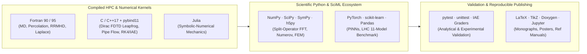

# Technical, Scientific Computing & AI-for-Science Portfolio

**Julian Leonardo Avila-Martinez**  
*Computational Physicist · Scientific Software Engineer · AI-for-Science & Mathematical Modeling*  
**Status:** **Available to begin immediately** (All 145 undergraduate credits & thesis defense completed; B.Sc. in Physics graduation ceremony December 2026 · Ranked 2nd in Cohort / Top 2%, GPA 4.54/5.00 · IELTS Academic 8.0 / C1 English · B1 German)

---

## 0. Verification Matrix for Scientific Computing & AI-for-Science Roles

The table below maps key hiring criteria for **Computational Physics, Scientific Software Engineering, and AI-for-Science / LLM Reasoning Evaluation** roles directly to verifiable artifacts hosted in this repository:

| Qualification / Requirement | Direct Evidence & Hosted Artifacts in Repository |
| :--- | :--- |
| **1. Peer-reviewed publications, preprints, or monographs involving computational/mathematical methods** | • **Undergraduate Thesis Monograph (Nominated for *Mención Meritoria*):** [`foundations-of-the-dirac-equation-thesis.pdf`](../projects/01-mathematical-and-theoretical-physics/undergraduate-thesis-dirac-clifford/foundations-of-the-dirac-equation-thesis.pdf) & [`thesis-defense-slides.pdf`](../projects/01-mathematical-and-theoretical-physics/undergraduate-thesis-dirac-clifford/thesis-defense-slides.pdf) • **Award-Winning CIFI-SEMA 2026 Poster (3rd Best Poster in Particle Physics) & Working Paper:** [`cifi-sema-2026-poster.pdf`](../projects/01-mathematical-and-theoretical-physics/chiral-dirac-and-neutrino-mass/cifi-sema-2026-poster.pdf) (*"Hermiticity and Mass Generation in the Chiral Dirac Equation"*, in preparation) • **Relativistic MHD (RRMHD) Slab-Jet Numerical Studies:** Presented at CoCoA 2024 & XXX CNF 2025 (**CUEVA** Group) • **Computational & Experimental Physics Papers:** [`pinn-fem-monograph.pdf`](../projects/04-nanomaterials-and-condensed-matter/nanotechnology-epistemology-and-monographs/sciml-and-nonlinear-dynamics-summary.pdf), [`lhc-ml-classification-report.pdf`](../projects/03-data-science-and-sciml/lhc-particle-classification/results-table.pdf), [`coupled-pendulums-paper.pdf`](../projects/05-experimental-systems-and-engineering/coupled-pendulums-normal-modes/coupled-pendulums-paper.pdf), [`agnp-nonlinear-optics-paper.pdf`](../projects/04-nanomaterials-and-condensed-matter/biogenic-agnp-nonlinear-optics/agnp-nonlinear-optics-review.pdf) |
| **2. Public simulation or analysis code** | • **C++17 / `pybind11` / Python (3+1)D Dirac FDTD & Split-Operator Solvers:** [`cpp_src/`](../projects/02-computational-physics-and-software/dirac-equation-solver/cpp_src/), [`dirac_solver/`](../projects/02-computational-physics-and-software/dirac-equation-solver/dirac_solver/), [`dirac_1d_split_operator.py`](../projects/02-computational-physics-and-software/dirac-equation-solver/dirac_solver/core.py) • **Fortran 90/95 Molecular Dynamics & Percolation:** [`md.f90`](../projects/02-computational-physics-and-software/molecular-dynamics-fortran90/DM.f90), [`lj.f90`](../projects/02-computational-physics-and-software/molecular-dynamics-fortran90/fuerzas.f90), [`percolacion.f90`](../projects/02-computational-physics-and-software/molecular-dynamics-fortran90/mod_DM.f90) • **5-Language 2D Laplace PDE Suite (Fortran 90, C, C++, Python, MATLAB):** [`laplace-2d-multilanguage-benchmark/`](../projects/02-computational-physics-and-software/laplace-2d-multilanguage-benchmark/) • **C++ Fluid & ODE Solvers / Julia Double Pendulum / Python FEM & PINN:** [`pipe_sim.cpp`](../projects/02-computational-physics-and-software/ode-solvers-and-simulations/fluid-sim.cpp), [`doble_pendulo.jl`](../projects/02-computational-physics-and-software/ode-solvers-and-simulations/Double-Pendulum-Julia.ipynb), [`pinn.py`](../projects/03-data-science-and-sciml/pinn-and-neural-oscillators/harmonic-perceptron.sync.py), [`fem.py`](../projects/03-data-science-and-sciml/pinn-and-neural-oscillators/data-generator.cpp) |
| **3. Research profiles (ORCID, CvLAC, GitHub)** | • **ORCID:** [`0009-0002-8630-1922`](https://orcid.org/0009-0002-8630-1922) • **Minciencias CvLAC (Colombian National Research Registry):** [`0002012647`](https://scienti.minciencias.gov.co/cvlac/visualizador/generarCurriculoCv.do?cod_rh=0002012647) • **GitHub:** [`@Julian-L-Avila`](https://github.com/Julian-L-Avila) · **LinkedIn:** [`julian-l-avila`](https://linkedin.com/in/julian-l-avila) |
| **4. Open-source scientific software contributions** | • **`dirac-solver` (MIT License, Software Registration Pending, 2026):** Modular C++17/`pybind11`/Python package with Builder, Strategy, Factory, and Observer patterns, Doxygen manual ([`dirac-solver-doxygen-refman.pdf`](../projects/02-computational-physics-and-software/dirac-equation-solver/dirac-solver-doxygen-refman.pdf)), HDF5 I/O, and `pytest` tests ([`test_integration.py`](../projects/02-computational-physics-and-software/dirac-equation-solver/tests/test_integration.py)) • **`gas_ideal`:** Unit-tested OOP 2D thermodynamic particle engine ([`test_gas.py`](../projects/02-computational-physics-and-software/ideal-gas-unit-tested/test_gas.py)) • **`sta-qed`:** Spacetime Algebra $\mathcal{C}\ell_{1,3}$ library specification ([`sta-qed-library-proposal.pdf`](../projects/02-computational-physics-and-software/sta-qed-and-dirac-solver-proposal/sta-qed-dirac-solver-proposal.pdf)) |
| **5. Reproducible notebooks, models, datasets, or simulations** | • **16 Executed Jupyter Notebooks (`.ipynb`) Hosted in `projects/`:** [`physics_verification.ipynb`](../projects/02-computational-physics-and-software/dirac-equation-solver/physics_verification.ipynb), [`dirac_solver_1d_example.ipynb`](../projects/02-computational-physics-and-software/dirac-equation-solver/dirac_solver_1d_example.ipynb), [`yukawa.ipynb`](../projects/02-computational-physics-and-software/dirac-equation-solver/yukawa.ipynb), [`numerov.ipynb`](../projects/02-computational-physics-and-software/numerov-quantum-and-graphene/basic-potentials.ipynb), [`graphene_tight_binding_executed.ipynb`](../projects/02-computational-physics-and-software/numerov-quantum-and-graphene/graphene.sync.ipynb), [`rk45.ipynb`](../projects/02-computational-physics-and-software/ode-solvers-and-simulations/adaptive-RK45.ipynb), [`anharmonic_oscillator_executed.ipynb`](../projects/02-computational-physics-and-software/ode-solvers-and-simulations/lab-non-linear-DE.sync.ipynb), [`pinn_executed.ipynb`](../projects/03-data-science-and-sciml/pinn-and-neural-oscillators/pinn-damped-oscillator.ipynb), [`fem_executed.ipynb`](../projects/02-computational-physics-and-software/ode-solvers-and-simulations/poisson-finite-elements.ipynb), [`normal_modes_analysis_executed_v2.ipynb`](../projects/05-experimental-systems-and-engineering/coupled-pendulums-normal-modes/normal_modes_analysis_executed_v2.ipynb), [`braun-tube-analysis.ipynb`](../projects/05-experimental-systems-and-engineering/modern-physics-experiments/braun-tube-analysis.ipynb), and 7 LHC classification notebooks |
| **6. Public benchmarks, experiments, or technical projects** | • **5-Language PDE Runtime Scaling Benchmark:** Fortran 90 (`0.097 s`) vs. C (`0.111 s`) vs. MATLAB (`0.130 s`) vs. C++ (`0.172 s`) vs. Python (`7.163 s`) ([`laplace-2d-finite-difference-report.pdf`](../projects/02-computational-physics-and-software/laplace-2d-multilanguage-benchmark/laplace-benchmark-report.pdf)) • **11-Model LHC Particle Classification Benchmark:** `90.3%` accuracy / `0.958` ROC-AUC ([`lhc-ml-classification-report.pdf`](../projects/03-data-science-and-sciml/lhc-particle-classification/results-table.pdf)) • **ODE Integrator IAE Accuracy vs. Cost Benchmark:** Euler, Heun, Taylor, RK4 ([`ode-integrators-benchmark.pdf`](../projects/02-computational-physics-and-software/ode-solvers-and-simulations/parachute-ode-comparison.cpp)) |
| **7. Creating AI-training tasks, reference answers, rubrics, graders, or benchmark problems** | • **AI-for-Physics Reasoning Benchmark (`Quantum-AI`):** Multi-stage quantum mechanics benchmark prompt, rubric, and step-by-step LaTeX reference derivation for a 4D Hilbert space CSCO $\{H,A,B\}$ ([`csco-4d-hilbert-space.pdf`](../projects/01-mathematical-and-theoretical-physics/quantum-mechanics-foundations/csco-4d-hilbert-space.pdf) & [`.tex`](../projects/01-mathematical-and-theoretical-physics/quantum-mechanics-foundations/csco-4d-hilbert-space.tex)) • **Academic Monitor (Teaching Assistant) & Clifford Seminar Leader (2025–2026):** Created structured problem sets, reference solutions, and grading rubrics across *Mathematical Methods for Physicists*, *Vector Calculus*, *Linear Algebra*, and *Physics I–II* (14 hrs/week) • **Automated Graders & Test Suites:** Programmatic verification harnesses in `pytest`/`unittest` ([`test_integration.py`](../projects/02-computational-physics-and-software/dirac-equation-solver/tests/test_integration.py), [`test_gas.py`](../projects/02-computational-physics-and-software/ideal-gas-unit-tested/test_gas.py), [`test_dirac_1d.py`](../projects/02-computational-physics-and-software/dirac-equation-solver/tests/test_integration.py)) and C++ IAE error evaluators ([`ieap.cpp`](../projects/05-experimental-systems-and-engineering/dynamical-systems-and-digital-alu/ieap.cpp)) |
| **8. Scientific Python stack (`NumPy`, `SciPy`, `SymPy`, `PyTorch`, etc.)** | • **`NumPy` & `SciPy`:** Spectral FFT (`scipy.fft`), dense/sparse eigensolvers (`scipy.linalg.eigh`), adaptive ODE integration (`scipy.integrate.solve_ivp`), nonlinear curve fitting (`scipy.optimize`) • **`SymPy`:** Symbolic Clifford/Dirac algebra manipulation, symbolic Euler–Lagrange equations, and exact eigenvalue verification • **`PyTorch` / Deep Learning & `scikit-learn`:** Autograd-based Physics-Informed Neural Networks ([`pinn.py`](../projects/03-data-science-and-sciml/pinn-and-neural-oscillators/harmonic-perceptron.sync.py)) and 11-model classification pipelines • **`pybind11`, `h5py`, `Pandas`, `Matplotlib`:** C++17 bindings, HDF5 persistence, data mining, and publication visualization |
| **9. Validating simulations or models against analytical results, observations, or experimental data** | • **Analytical vs. Numerical PDE/Quantum Validation:** [`physics_verification.ipynb`](../projects/02-computational-physics-and-software/dirac-equation-solver/physics_verification.ipynb) (Dirac CFL limit, unitary norm conservation, dispersion), [`numerov.ipynb`](../projects/02-computational-physics-and-software/numerov-quantum-and-graphene/basic-potentials.ipynb) ($\mathcal{O}(h^6)$ bound states vs. exact eigenvalues), [`pinn-fem-monograph.pdf`](../projects/04-nanomaterials-and-condensed-matter/nanotechnology-epistemology-and-monographs/sciml-and-nonlinear-dynamics-summary.pdf) • **Experimental FFT & Step-Response Validation:** Coupled-pendulum analytical eigenmodes validated against experimental video-tracked FFT peaks ([`coupled-pendulums-paper.pdf`](../projects/05-experimental-systems-and-engineering/coupled-pendulums-normal-modes/coupled-pendulums-paper.pdf)); transfer-function thermal models validated against experimental furnace data ([`electric-furnace-system-identification.pdf`](../projects/05-experimental-systems-and-engineering/dynamical-systems-and-digital-alu/electric-furnace-system-identification.pdf)) |
| **10. Availability to begin immediately** | • **Immediate full-time or part-time availability:** All 10 semesters (145 credits) of B.Sc. in Physics coursework and thesis defense (*Acta No. 020 de 2026*) are 100% completed; awaiting only the formal graduation ceremony in December 2026. |

---

## 1. Scientific Software Architecture & High-Performance Computing (HPC)

### 1.1 `dirac-solver`: Hybrid C++17 / `pybind11` / Python Package for the (3+1)D Dirac Equation
- **Direct Files:** [`projects/02-computational-physics-and-software/dirac-equation-solver/`](../projects/02-computational-physics-and-software/dirac-equation-solver/)
- **Architecture & Design Patterns ([`design-pattern.md`](../projects/02-computational-physics-and-software/dirac-equation-solver/design-pattern.md), [`requirements-engineering.md`](../projects/02-computational-physics-and-software/dirac-equation-solver/requirements-engineering.md)):**
  - **C++17 Computational Engine (`cpp_src/`):** Implements an explicit staggered-leapfrog Finite-Difference Time-Domain (FDTD) integrator (`FDTDLeapfrogIntegrator` in [`TimeIntegrator.h`](../projects/02-computational-physics-and-software/dirac-equation-solver/cpp_src/TimeIntegrator.h)) over 1D/2D/3D spatial grids ([`Grid.h`](../projects/02-computational-physics-and-software/dirac-equation-solver/cpp_src/Grid.h)) with polymorphic potentials (`FreeParticle`, `ScalarPotential`, `CoulombPotential`) and boundary conditions (`PeriodicBoundary`, `AbsorbingBoundary`), exposed to Python via `pybind11` ([`bindings.cpp`](../projects/02-computational-physics-and-software/dirac-equation-solver/cpp_src/bindings.cpp)) and packaged with `scikit-build-core` ([`pyproject.toml`](../projects/02-computational-physics-and-software/dirac-equation-solver/pyproject.toml)).
  - **Canonical Software Design Patterns:** Applies the **Builder** pattern (`DiracProblemBuilder`) for fluent simulation assembly, **Strategy** pattern (`TimeIntegrator`, `BoundaryCondition`) for interchangeable numerical schemes, **Template + Factory Method** for physical potentials, and **Observer/Facade** for HDF5 persistence (`h5py`) and observable tracking.
  - **Physics Verification & Automated Testing:** Includes `pytest` integration tests ([`test_integration.py`](../projects/02-computational-physics-and-software/dirac-equation-solver/tests/test_integration.py)), full Doxygen reference documentation ([`dirac-solver-doxygen-refman.pdf`](../projects/02-computational-physics-and-software/dirac-equation-solver/dirac-solver-doxygen-refman.pdf)), and verification notebooks ([`physics_verification.ipynb`](../projects/02-computational-physics-and-software/dirac-equation-solver/physics_verification.ipynb), [`dirac_solver_1d_example.ipynb`](../projects/02-computational-physics-and-software/dirac-equation-solver/dirac_solver_1d_example.ipynb), [`yukawa.ipynb`](../projects/02-computational-physics-and-software/dirac-equation-solver/yukawa.ipynb)).
  - **Companion 1D Split-Operator FFT Solver:** [`dirac_1d_split_operator.py`](../projects/02-computational-physics-and-software/dirac-equation-solver/dirac_solver/core.py) & [`test_dirac_1d.py`](../projects/02-computational-physics-and-software/dirac-equation-solver/tests/test_integration.py) — Exact momentum-space $2\times 2$ matrix exponential $\exp(-i\Delta t(c p_x \sigma_x + m c^2 \sigma_z)/\hbar)$ eliminating spatial finite-difference dispersion errors for Klein paradox and Zitterbewegung benchmarks.

### 1.2 Multi-Language PDE Benchmark: 2D Laplace / Poisson Finite-Difference Suite
- **Direct Files:** [`projects/02-computational-physics-and-software/laplace-2d-multilanguage-benchmark/`](../projects/02-computational-physics-and-software/laplace-2d-multilanguage-benchmark/) ([`laplace-2d-finite-difference-report.pdf`](../projects/02-computational-physics-and-software/laplace-2d-multilanguage-benchmark/laplace-benchmark-report.pdf), [`diffinita.f90`](../projects/02-computational-physics-and-software/laplace-2d-multilanguage-benchmark/diffinita.f90), [`diffinita.c`](../projects/02-computational-physics-and-software/laplace-2d-multilanguage-benchmark/diffinita.c), [`diffinita.cpp`](../projects/02-computational-physics-and-software/laplace-2d-multilanguage-benchmark/plot_times.py), [`diffinita.py`](../projects/02-computational-physics-and-software/laplace-2d-multilanguage-benchmark/diffinita.py), [`diffinita.m`](../projects/02-computational-physics-and-software/laplace-2d-multilanguage-benchmark/diffinita.m))
- **Quantitative Runtime & Memory Benchmark ($50 \times 50$ Grid, $10^4$ Iterations):**

| Language | Compiler / Interpreter | Execution Time (s) | Relative Speedup vs. Python |
| :--- | :--- | :---: | :---: |
| **Fortran 90** | `gfortran -O3` | **0.097 s** | **73.8×** |
| **C** | `gcc -O3` | **0.111 s** | **64.5×** |
| **MATLAB** | JIT Vectorized | **0.130 s** | **55.1×** |
| **C++** | `g++ -O3` (`std::vector`) | **0.172 s** | **41.6×** |
| **Python** | CPython / NumPy loop | **7.163 s** | **1.0×** |

### 1.3 Fortran 90 Molecular Dynamics & Statistical Percolation
- **Direct Files:** [`projects/02-computational-physics-and-software/molecular-dynamics-fortran90/`](../projects/02-computational-physics-and-software/molecular-dynamics-fortran90/) ([`molecular-dynamics-report.pdf`](../projects/02-computational-physics-and-software/molecular-dynamics-fortran90/Makefile), [`md.f90`](../projects/02-computational-physics-and-software/molecular-dynamics-fortran90/DM.f90), [`lj.f90`](../projects/02-computational-physics-and-software/molecular-dynamics-fortran90/fuerzas.f90), [`potencial.f90`](../projects/02-computational-physics-and-software/molecular-dynamics-fortran90/integracion.f90), [`percolacion.f90`](../projects/02-computational-physics-and-software/molecular-dynamics-fortran90/mod_DM.f90))
- **Highlights:** Velocity-Verlet symplecticity, Lennard-Jones 12-6 pairwise force evaluation with minimum-image periodic boundary conditions, microcanonical $(N,V,E)$ energy conservation validation, and 3D lattice percolation cluster analysis.

### 1.4 $\mathcal{O}(h^6)$ Numerov Quantum Solver, Adaptive RK45 & C++ Pipe Flow Simulator
- **Direct Files:** [`projects/02-computational-physics-and-software/numerov-quantum-and-graphene/`](../projects/02-computational-physics-and-software/numerov-quantum-and-graphene/) & [`ode-solvers-and-simulations/`](../projects/02-computational-physics-and-software/ode-solvers-and-simulations/)
- **Highlights:**
  - **Numerov $\mathcal{O}(h^6)$ Quantum Solver ([`numerov.ipynb`](../projects/02-computational-physics-and-software/numerov-quantum-and-graphene/basic-potentials.ipynb), [`numerov-method-report.pdf`](../projects/02-computational-physics-and-software/numerov-quantum-and-graphene/basic-potentials.ipynb)):** Solves 1D time-independent Schrödinger equations for harmonic, anharmonic, and double-well potentials with shooting-method boundary matching validated against analytical harmonic eigenvalues $E_n = \hbar\omega(n+1/2)$.
  - **ODE Integrators Benchmark ([`ode-integrators-benchmark.pdf`](../projects/02-computational-physics-and-software/ode-solvers-and-simulations/parachute-ode-comparison.cpp), [`rk45.ipynb`](../projects/02-computational-physics-and-software/ode-solvers-and-simulations/adaptive-RK45.ipynb), [`anharmonic_oscillator_executed.ipynb`](../projects/02-computational-physics-and-software/ode-solvers-and-simulations/lab-non-linear-DE.sync.ipynb), [`doble_pendulo.jl`](../projects/02-computational-physics-and-software/ode-solvers-and-simulations/Double-Pendulum-Julia.ipynb)):** Compares Euler, Heun, 4th-order Taylor, RK4, and Dormand–Prince adaptive RK45 integrators against exact analytical solutions via Integral Absolute Error (IAE).
  - **2D Pipe Fluid Simulator ([`pipe_sim.cpp`](../projects/02-computational-physics-and-software/ode-solvers-and-simulations/fluid-sim.cpp), [`pipe-flow-simulation-report.pdf`](../projects/02-computational-physics-and-software/ode-solvers-and-simulations/fluid-sim-explain.md)):** Custom C++ physical engine modeling viscous Poiseuille velocity profiles, wall collisions, and pressure-gradient transport.

---

## 2. Scientific Machine Learning (SciML), PINNs & High-Energy Data Mining

### 2.1 Physics-Informed Neural Networks (PINNs) vs. 2D Galerkin Finite Element Method (FEM)
- **Direct Files:** [`projects/03-data-science-and-sciml/pinn-and-neural-oscillators/`](../projects/03-data-science-and-sciml/pinn-and-neural-oscillators/) ([`pinn-fem-monograph.pdf`](../projects/04-nanomaterials-and-condensed-matter/nanotechnology-epistemology-and-monographs/sciml-and-nonlinear-dynamics-summary.pdf), [`pinn_executed.ipynb`](../projects/03-data-science-and-sciml/pinn-and-neural-oscillators/pinn-damped-oscillator.ipynb), [`pinn.py`](../projects/03-data-science-and-sciml/pinn-and-neural-oscillators/harmonic-perceptron.sync.py), [`fem_executed.ipynb`](../projects/02-computational-physics-and-software/ode-solvers-and-simulations/poisson-finite-elements.ipynb), [`fem.py`](../projects/03-data-science-and-sciml/pinn-and-neural-oscillators/data-generator.cpp))
- **Contributions:**
  - Formulates the weak variational Galerkin discretization for 2D elliptic boundary-value problems ($-\nabla^2 u = f$) over unstructured Delaunay triangular meshes, assembling global sparse stiffness matrices and validating convergence against analytical solutions.
  - Implements a mesh-free **Physics-Informed Neural Network (PINN)** embedding the differential operator residual directly into the composite loss function:
    $$\mathcal{L}(\theta) = \lambda_{\text{ODE}}\frac{1}{N_f}\sum_{i=1}^{N_f}\left|\mathcal{N}[u_\theta](t_i)\right|^2 + \lambda_{\text{IC}}\left(\left|u_\theta(0) - u_0\right|^2 + \left|\partial_t u_\theta(0) - v_0\right|^2\right),$$
    using automatic differentiation to solve the damped harmonic oscillator ($m\ddot{x} + c\dot{x} + kx = 0$) and benchmarking convergence and $L^2$ error against exact analytical trajectories.

### 2.2 LHC High-Energy Particle Collision Classification (11-Model Benchmark)
- **Direct Files:** [`projects/03-data-science-and-sciml/lhc-particle-classification/`](../projects/03-data-science-and-sciml/lhc-particle-classification/) ([`lhc-ml-classification-report.pdf`](../projects/03-data-science-and-sciml/lhc-particle-classification/results-table.pdf) and 7 executed notebooks)
- **Quantitative Benchmark Results (`36,358` Collision Events · 12 Kinematic Features $E, p_T, \eta, \phi$):**

| Model Architecture | Hyperparameters / Configuration | Test Accuracy | F1-Score | ROC-AUC |
| :--- | :--- | :---: | :---: | :---: |
| **Multi-Layer Perceptron (MLP)** | `32-16` hidden units, ReLU, Adam (`lr=1e-3`) | **90.3%** | **0.903** | **0.958** |
| **Random Forest Classifier** | 200 trees, Gini criterion, max depth tuned | **88.9%** | **0.888** | **0.953** |
| **SVM (RBF Kernel)** | $C=10.0$, $\gamma=\text{scale}$ | **88.7%** | **0.886** | **0.950** |
| **SVM (Polynomial Kernel)** | Degree 3 | **84.2%** | **0.840** | **0.918** |
| **Decision Tree** | Pruned max depth 10 | **85.4%** | **0.853** | **0.912** |
| **K-Nearest Neighbors (KNN)** | $k=15$, Euclidean distance | **83.1%** | **0.830** | **0.904** |
| **Logistic Regression / Linear SVM / Naive Bayes** | Linear baseline models | `53.2% – 57.5%` | `0.53 – 0.57` | `0.56 – 0.61` |

---

## 3. Control Systems, System Identification & Digital Hardware Design

1. **Experimental System Identification of an Electric Furnace ([`electric-furnace-system-identification.pdf`](../projects/05-experimental-systems-and-engineering/dynamical-systems-and-digital-alu/electric-furnace-system-identification.pdf), [`ieap.cpp`](../projects/05-experimental-systems-and-engineering/dynamical-systems-and-digital-alu/ieap.cpp)):**
   - Identifies first-order and second-order plus dead-time (FOPDT / SOPDT) transfer functions $G(s) = \frac{K e^{-\tau_d s}}{(T_1 s + 1)(T_2 s + 1)}$ from experimental thermal step-response curves using the **Alfaro (123c)**, **Stark**, and **Jahanmiri–Fallahi** analytical methods alongside MATLAB System Identification Toolbox optimization.
   - Evaluates goodness-of-fit against experimental data via a custom C++ Integral Absolute Error (IAE) grader (`ieap.cpp`).
2. **4-DOF Biomechanical State-Space Vibration Modeling ([`wan-schimmels-human-body-vibrations.pdf`](../projects/05-experimental-systems-and-engineering/dynamical-systems-and-digital-alu/wan-schimmels-human-body-vibrations.pdf), [`wan.py`](../projects/05-experimental-systems-and-engineering/dynamical-systems-and-digital-alu/wan.py)):**
   - Formulates the 4-degree-of-freedom Wan–Schimmels linear state-space system $\dot{\mathbf{x}} = \mathbf{A}\mathbf{x} + \mathbf{B}\mathbf{u}$ (8 state variables) in Python (`scipy.signal`, `scipy.integrate`) to analyze frequency-response transmissibility and resonant modes.
3. **4-Bit TTL Arithmetic Logic Unit (ALU) Hardware Design ([`4bit-alu-design-report.pdf`](../projects/05-experimental-systems-and-engineering/dynamical-systems-and-digital-alu/4bit-alu-design-report.pdf), [`Simulation.kicad_sch`](../projects/05-experimental-systems-and-engineering/dynamical-systems-and-digital-alu/Simulation.kicad_sch)):**
   - Bottom-up combinational gate-level synthesis, Karnaugh-map minimization, carry-ripple adder/subtractor with two's complement overflow detection, bitwise logic unit, and 4-to-1 multiplexing validated in KiCad/SPICE.
