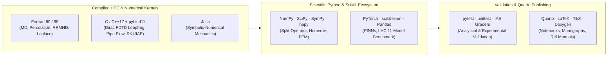

# Scientific Computing, Software Engineering & SciML Portfolio

**Julian L. Avila-Martinez**  
*Computational Physicist · Scientific Software Developer · SciML & Mathematical Modeling*  
**B.Sc. in Physics (*Pregrado en Física*)** — Universidad Distrital Francisco José de Caldas (Bogotá D.C., Colombia · Graduation: December 2026)  
**Interactive Quarto Gallery:** [`../notebooks/index.html`](../notebooks/index.html)

---

## 1. Scientific Software Architecture & High-Performance Computing (HPC)

### 1.1 `dirac-solver`: Hybrid C++17 / `pybind11` / Python Package for the (3+1)D Dirac Equation
- **Quarto Published Notebooks & Code:** [`../notebooks/dirac-physics-verification.html`](../notebooks/dirac-physics-verification.html) & [`../notebooks/dirac-1d-and-yukawa.html`](../notebooks/dirac-1d-and-yukawa.html)
- **Direct Files:** [`projects/02-computational-physics-and-software/dirac-equation-solver/`](../projects/02-computational-physics-and-software/dirac-equation-solver/)
- **Architecture & Design Patterns ([`design-pattern.md`](../projects/02-computational-physics-and-software/dirac-equation-solver/design-pattern.md), [`requirements-engineering.md`](../projects/02-computational-physics-and-software/dirac-equation-solver/requirements-engineering.md)):**
  - **C++17 Computational Engine (`cpp_src/`):** Implements an explicit staggered-leapfrog Finite-Difference Time-Domain (FDTD) integrator (`FDTDLeapfrogIntegrator` in [`TimeIntegrator.h`](../projects/02-computational-physics-and-software/dirac-equation-solver/cpp_src/TimeIntegrator.h)) over 1D/2D/3D spatial grids ([`Grid.h`](../projects/02-computational-physics-and-software/dirac-equation-solver/cpp_src/Grid.h)) with polymorphic potentials (`FreeParticle`, `ScalarPotential`, `CoulombPotential`, `YukawaPotential`) and boundary conditions (`PeriodicBoundary`, `AbsorbingBoundary`), exposed to Python via `pybind11` ([`bindings.cpp`](../projects/02-computational-physics-and-software/dirac-equation-solver/cpp_src/bindings.cpp)) and packaged with `scikit-build-core` ([`pyproject.toml`](../projects/02-computational-physics-and-software/dirac-equation-solver/pyproject.toml)).
  - **Canonical Software Design Patterns:** Applies the **Builder** pattern (`DiracProblemBuilder`) for fluent simulation assembly, **Strategy** pattern (`TimeIntegrator`, `BoundaryCondition`) for interchangeable numerical schemes, **Template + Factory Method** for physical potentials, and **Observer/Facade** for HDF5 persistence (`h5py`) and observable tracking.
  - **Physics Verification & Automated Testing:** Includes `pytest` integration tests ([`test_integration.py`](../projects/02-computational-physics-and-software/dirac-equation-solver/tests/test_integration.py)), full Doxygen reference documentation ([`dirac-solver-doxygen-refman.pdf`](../projects/02-computational-physics-and-software/dirac-equation-solver/dirac-solver-doxygen-refman.pdf)), and verification notebooks ([`physics_verification.ipynb`](../projects/02-computational-physics-and-software/dirac-equation-solver/physics_verification.ipynb), [`dirac_solver_1d_example.ipynb`](../projects/02-computational-physics-and-software/dirac-equation-solver/dirac_solver_1d_example.ipynb), [`yukawa.ipynb`](../projects/02-computational-physics-and-software/dirac-equation-solver/yukawa.ipynb)).

### 1.2 Multi-Language PDE Benchmark: 2D Laplace / Poisson Finite-Difference Suite
- **Quarto Published Code Showcase:** [`../notebooks/hpc-multilanguage-code-showcase.html`](../notebooks/hpc-multilanguage-code-showcase.html)
- **Direct Files:** [`projects/02-computational-physics-and-software/laplace-2d-multilanguage-benchmark/`](../projects/02-computational-physics-and-software/laplace-2d-multilanguage-benchmark/) ([`laplace-benchmark-report.pdf`](../projects/02-computational-physics-and-software/laplace-2d-multilanguage-benchmark/laplace-benchmark-report.pdf), [`diffinita.f90`](../projects/02-computational-physics-and-software/laplace-2d-multilanguage-benchmark/diffinita.f90), [`diffinita.c`](../projects/02-computational-physics-and-software/laplace-2d-multilanguage-benchmark/diffinita.c), [`diffinita.py`](../projects/02-computational-physics-and-software/laplace-2d-multilanguage-benchmark/diffinita.py), [`diffinita.m`](../projects/02-computational-physics-and-software/laplace-2d-multilanguage-benchmark/diffinita.m))
- **Quantitative Runtime Benchmark ($50 \times 50$ Grid, $10^4$ Iterations):**

| Language | Compiler / Interpreter | Execution Time (s) | Relative Speedup vs. Python |
| :--- | :--- | :---: | :---: |
| **Fortran 90** | `gfortran -O3` | **0.097 s** | **73.8×** |
| **C** | `gcc -O3` | **0.111 s** | **64.5×** |
| **MATLAB** | JIT Vectorized | **0.130 s** | **55.1×** |
| **C++** | `g++ -O3` (`std::vector`) | **0.172 s** | **41.6×** |
| **Python** | CPython / NumPy loop | **7.163 s** | **1.0×** |

### 1.3 Fortran 90 Molecular Dynamics & Statistical Simulation
- **Direct Files:** [`projects/02-computational-physics-and-software/molecular-dynamics-fortran90/`](../projects/02-computational-physics-and-software/molecular-dynamics-fortran90/) ([`DM.f90`](../projects/02-computational-physics-and-software/molecular-dynamics-fortran90/DM.f90), [`fuerzas.f90`](../projects/02-computational-physics-and-software/molecular-dynamics-fortran90/fuerzas.f90), [`integracion.f90`](../projects/02-computational-physics-and-software/molecular-dynamics-fortran90/integracion.f90), [`mod_DM.f90`](../projects/02-computational-physics-and-software/molecular-dynamics-fortran90/mod_DM.f90), [`Makefile`](../projects/02-computational-physics-and-software/molecular-dynamics-fortran90/Makefile))
- **Highlights:** Velocity-Verlet symplecticity, Lennard-Jones 12-6 pairwise force evaluation with minimum-image periodic boundary conditions, and microcanonical $(N,V,E)$ energy conservation validation.

### 1.4 $\mathcal{O}(h^6)$ Numerov Quantum Solver, Adaptive RK45 & C++ Pipe Flow Simulator
- **Quarto Published Notebooks:** [`../notebooks/numerov-quantum-potentials.html`](../notebooks/numerov-quantum-potentials.html), [`../notebooks/graphene-tight-binding.html`](../notebooks/graphene-tight-binding.html), [`../notebooks/adaptive-rk45-and-nonlinear-odes.html`](../notebooks/adaptive-rk45-and-nonlinear-odes.html), [`../notebooks/double-pendulum-julia.html`](../notebooks/double-pendulum-julia.html)
- **Direct Files:** [`projects/02-computational-physics-and-software/numerov-quantum-and-graphene/`](../projects/02-computational-physics-and-software/numerov-quantum-and-graphene/) & [`ode-solvers-and-simulations/`](../projects/02-computational-physics-and-software/ode-solvers-and-simulations/)

---

## 2. Scientific Machine Learning (SciML), PINNs & High-Energy Data Mining

### 2.1 Physics-Informed Neural Networks (PINNs) & 2D Galerkin Finite Element Method (FEM)
- **Quarto Published Notebooks:** [`../notebooks/pinn-damped-oscillator.html`](../notebooks/pinn-damped-oscillator.html) & [`../notebooks/poisson-finite-elements.html`](../notebooks/poisson-finite-elements.html)
- **Direct Files:** [`projects/03-data-science-and-sciml/pinn-and-neural-oscillators/`](../projects/03-data-science-and-sciml/pinn-and-neural-oscillators/) ([`pinn-damped-oscillator.ipynb`](../projects/03-data-science-and-sciml/pinn-and-neural-oscillators/pinn-damped-oscillator.ipynb), [`best-model-avila-huertas.ipynb`](../projects/03-data-science-and-sciml/pinn-and-neural-oscillators/best-model-avila-huertas.ipynb), [`harmonic-perceptron.sync.py`](../projects/03-data-science-and-sciml/pinn-and-neural-oscillators/harmonic-perceptron.sync.py), [`data-generator.cpp`](../projects/03-data-science-and-sciml/pinn-and-neural-oscillators/data-generator.cpp)) and [`poisson-finite-elements.ipynb`](../projects/02-computational-physics-and-software/ode-solvers-and-simulations/poisson-finite-elements.ipynb)

### 2.2 LHC High-Energy Particle Collision Classification (11-Model Benchmark)
- **Quarto Published Notebooks:** [`../notebooks/lhc-particle-classification.html`](../notebooks/lhc-particle-classification.html)
- **Direct Files:** [`projects/03-data-science-and-sciml/lhc-particle-classification/`](../projects/03-data-science-and-sciml/lhc-particle-classification/) ([`results-table.pdf`](../projects/03-data-science-and-sciml/lhc-particle-classification/results-table.pdf), [`classification-methods-comparison.ipynb`](../projects/03-data-science-and-sciml/lhc-particle-classification/classification-methods-comparison.ipynb), [`knn-classification.ipynb`](../projects/03-data-science-and-sciml/lhc-particle-classification/knn-classification.ipynb), [`particles.ipynb`](../projects/03-data-science-and-sciml/lhc-particle-classification/particles.ipynb))

| Model Architecture | Hyperparameters / Configuration | Test Accuracy | F1-Score | ROC-AUC |
| :--- | :--- | :---: | :---: | :---: |
| **Multi-Layer Perceptron (MLP)** | `32-16` hidden units, ReLU, Adam (`lr=1e-3`) | **90.3%** | **0.903** | **0.958** |
| **Random Forest Classifier** | 200 trees, Gini criterion, max depth tuned | **88.9%** | **0.888** | **0.953** |
| **SVM (RBF Kernel)** | $C=10.0$, $\gamma=\text{scale}$ | **88.7%** | **0.886** | **0.950** |
| **SVM (Polynomial Kernel)** | Degree 3 | **84.2%** | **0.840** | **0.918** |
| **Decision Tree** | Pruned max depth 10 | **85.4%** | **0.853** | **0.912** |
| **K-Nearest Neighbors (KNN)** | $k=15$, Euclidean distance | **83.1%** | **0.830** | **0.904** |

---

## 3. Control Systems, System Identification & Digital Hardware Design

1. **Experimental System Identification of an Electric Furnace ([`electric-furnace-system-identification.pdf`](../projects/05-experimental-systems-and-engineering/dynamical-systems-and-digital-alu/electric-furnace-system-identification.pdf), [`ieap.cpp`](../projects/05-experimental-systems-and-engineering/dynamical-systems-and-digital-alu/ieap.cpp)):**
   - Identifies first-order and second-order plus dead-time (FOPDT / SOPDT) transfer functions from experimental thermal step-response curves using the **Alfaro (123c)**, **Stark**, and **Jahanmiri–Fallahi** analytical methods alongside MATLAB System Identification Toolbox optimization, validated via a custom C++ Integral Absolute Error (IAE) grader (`ieap.cpp`).
2. **4-DOF Biomechanical State-Space Vibration Modeling ([`wan-schimmels-human-body-vibrations.pdf`](../projects/05-experimental-systems-and-engineering/dynamical-systems-and-digital-alu/wan-schimmels-human-body-vibrations.pdf), [`wan.py`](../projects/05-experimental-systems-and-engineering/dynamical-systems-and-digital-alu/wan.py)):**
   - Formulates the 4-degree-of-freedom Wan–Schimmels linear state-space system $\dot{\mathbf{x}} = \mathbf{A}\mathbf{x} + \mathbf{B}\mathbf{u}$ (8 state variables) in Python (`scipy.signal`, `scipy.integrate`).
3. **4-Bit TTL Arithmetic Logic Unit (ALU) Hardware Design ([`4bit-alu-design-report.pdf`](../projects/05-experimental-systems-and-engineering/dynamical-systems-and-digital-alu/4bit-alu-design-report.pdf), [`Simulation.kicad_sch`](../projects/05-experimental-systems-and-engineering/dynamical-systems-and-digital-alu/Simulation.kicad_sch)):**
   - Combinational gate-level synthesis, Karnaugh-map minimization, carry-ripple adder/subtractor with two's complement overflow detection, bitwise logic unit, and 4-to-1 multiplexing validated in KiCad/SPICE.
